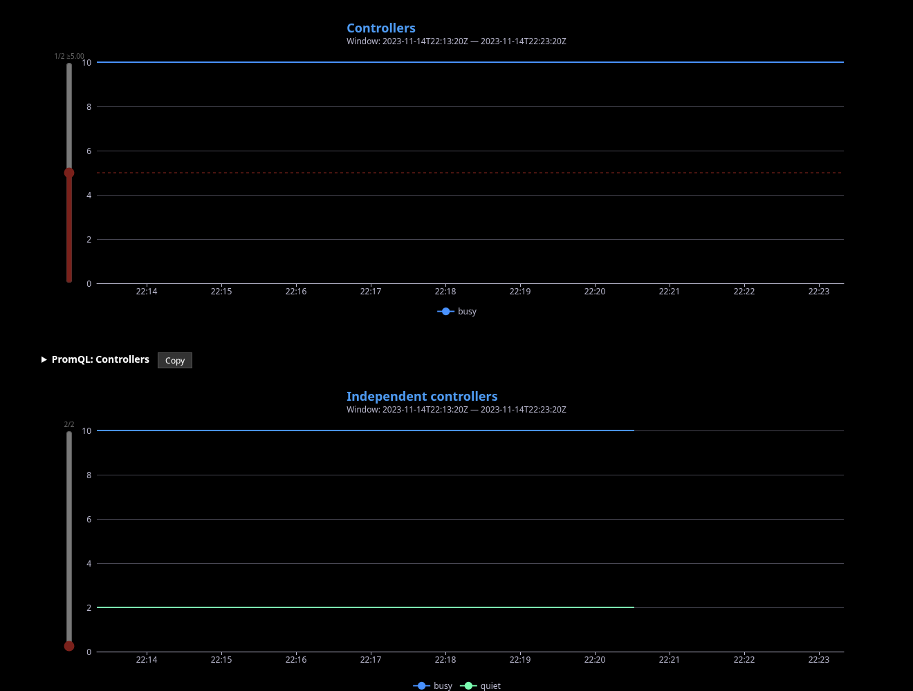
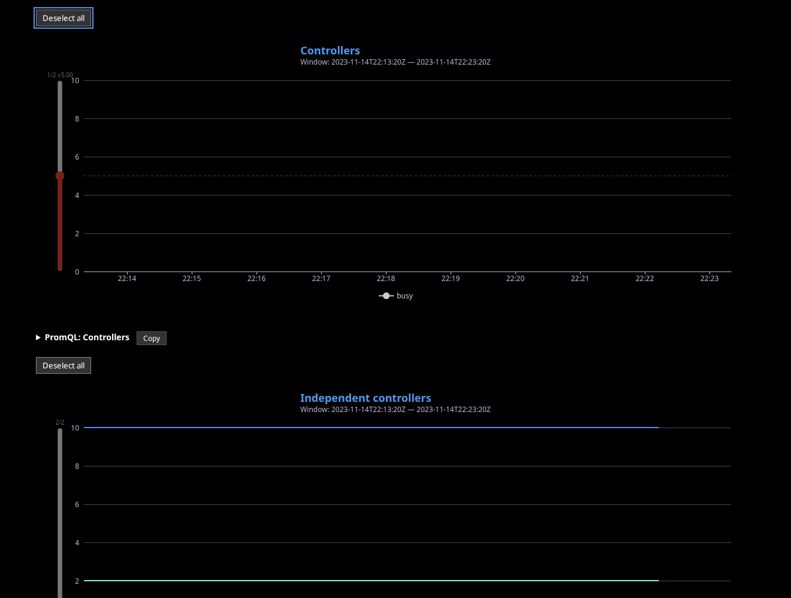
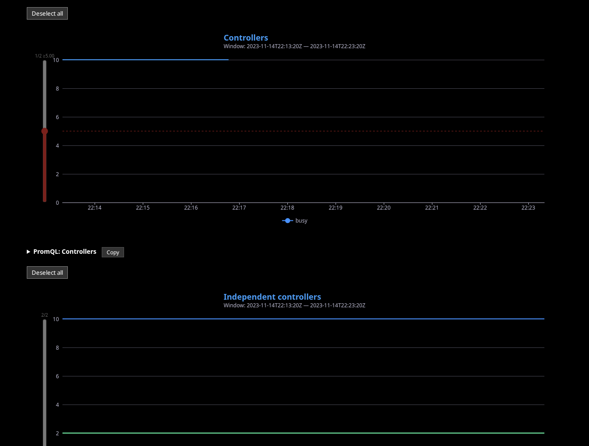

# PR 7640: synthetic metrics selection evidence

These screenshots are prepared for an evidence-only branch in the bot fork,
separate from the feature branch. They have not been published in this phase.

- `before.png`: original report without Deselect all controls.
- `after-deselected.png`: keyboard activation clears the first graph while its
  eligible busy-controller legend entry remains available; the sibling graph
  remains selected. The first graph's existing minimum-peak threshold is 5.
- `after-reselected.png`: clicking that legend entry enables one controller.

## Provenance and privacy

Captured from the synthetic `selectionTestPanel` fixture in `chart_test.go`,
using invented busy/quiet controller values (10 and 2) and a fixed 2023 time
window. All three images were visually inspected. They contain only synthetic
chart labels and data, with no private artifact data, credentials, resource
identifiers, Slack content, or attribution.

The original feature commit is
`1f8654d2a00c044247aa84b58cd1bc11976c0c69`. The current base is
`2b3660f349ce5236b54342acf823ac52458ff829`.
The metrics template, chart builder, renderer and fixture file are unchanged
between that feature commit and its rebased version. The review fix only changes
the browser test's asset setup, so these screenshots remain representative.
The images capture chart animation at different times; partial horizontal line
lengths are animation frames, not changed data or filtering semantics.

Publish only this directory on the later evidence-only branch and link these
images from the existing PR. Do not add them to the feature diff.
